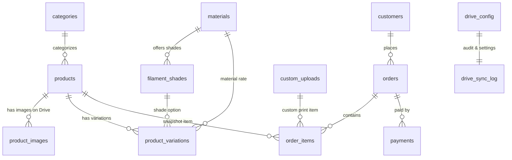
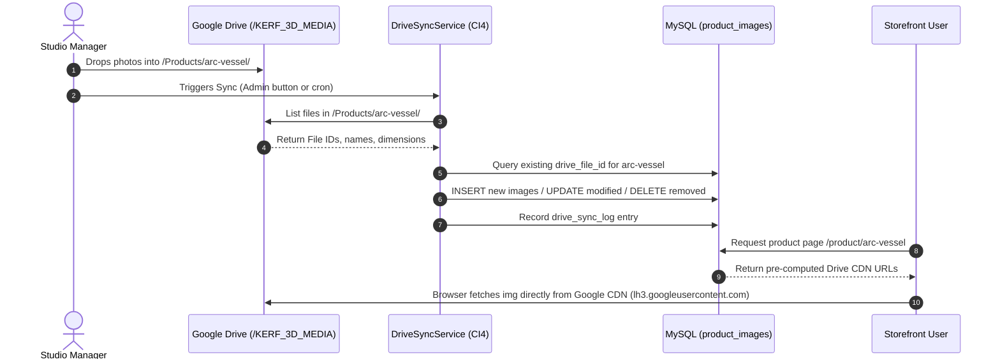

# Kerf 3D — Database & Google Drive Architecture Specification

## 1. Architectural Philosophy

The Kerf 3D application separates **transactional relational data** from **heavy media and CAD assets**:

```text
┌─────────────────────────────────┐        ┌──────────────────────────────────┐
│          Google Drive           │        │         MySQL 8.x (kerf3d)       │
│                                 │        │                                  │
│  /KERF_3D_MEDIA/                │        │  • Fast, indexed queries         │
│    ├── /Products/               │◄─sync──┤  • Zero binary BLOBs             │
│    │     └── /{product-slug}/   │        │  • Ultra-lightweight disk usage  │
│    │           ├── 01.webp      │        │  • Stores Drive File IDs & URLs  │
│    │           └── 02.webp      │        │  • Tracks variation combinations │
│    └── /Customer_Uploads/       │        │  • Audit trail for TrxID MFS     │
│          └── /{session-or-order}│        │  • Session-based carts & orders  │
│                └── model.stl    │        └──────────────────────────────────┘
└─────────────────────────────────┘
```

### Why this design?
1. **Lightweight MySQL**: Traditional ecommerce databases balloon rapidly when storing product photography and user-uploaded 3D meshes (128 MB limit). Storing only URLs and metadata keeps database backups small (megabytes rather than gigabytes) and queries fast.
2. **Simplified Catalog Management**: The store owner can create a folder on Google Drive matching the product slug, drop photos in, and trigger a sync. No complex custom image uploader UI is required at launch.
3. **Google's Global CDN Delivery**: Images are served directly through Google's edge cache (`lh3.googleusercontent.com/d/{FILE_ID}` and thumbnail generators), reducing load on the OpenLiteSpeed application server.

---

## 2. Google Drive Structure & Taxonomy

### Folder Hierarchy
```text
Google Drive Root
└── KERF_3D_MEDIA/                     (Shared with Service Account as Editor)
    ├── Products/                      (Root folder for catalog imagery)
    │   ├── arc-vessel/                (Folder name exactly matches product slug)
    │   │   ├── 01-primary.webp
    │   │   ├── 02-detail.webp
    │   │   └── 03-angle.webp
    │   ├── grid-dock/
    │   │   ├── 01-primary.webp
    │   │   └── 02-detail.webp
    │   └── ...
    └── Customer_Uploads/              (Storage for customer STL, OBJ, and 3MF files)
        ├── sess_9a8f7b6c/
        │   └── custom-bracket.stl
        └── ...
```

### Google Drive URL Patterns
| Purpose | URL Format | Cache & Performance |
|---|---|---|
| **Direct Display** | `https://lh3.googleusercontent.com/d/{FILE_ID}` | Google Edge CDN, responsive delivery |
| **Sized Thumbnail** | `https://drive.google.com/thumbnail?id={FILE_ID}&sz=w{WIDTH}` | Dynamic sizing (e.g., `sz=w400` for grid, `sz=w120` for cart) |
| **Direct Download** | `https://drive.google.com/uc?export=download&id={FILE_ID}` | Download prompt for workshop print operators |
| **Browser Preview** | `https://drive.google.com/file/d/{FILE_ID}/view` | Inspector link in private admin portal |

---

## 3. Entity-Relationship Diagram



---

## 4. Database Schema Specifications

### Table 1: `categories`
Defines hierarchical catalog categories (e.g., "Vessels", "Desk Objects", "Architectural", "Hardware").
- `id` (INT UNSIGNED, PK, AUTO_INCREMENT)
- `name` (VARCHAR(120), NOT NULL)
- `slug` (VARCHAR(120), NOT NULL, UNIQUE)
- `description` (TEXT, NULL)
- `parent_id` (INT UNSIGNED, NULL, FK -> categories.id ON DELETE SET NULL)
- `sort_order` (INT UNSIGNED, DEFAULT 0)
- `created_at`, `updated_at` (DATETIME)

### Table 2: `materials`
Defines printable polymers with fixed pricing rates and physical properties for quoting.
- `id` (INT UNSIGNED, PK, AUTO_INCREMENT)
- `name` (VARCHAR(60), NOT NULL, UNIQUE) — e.g. "PLA", "TPU 95A", "PETG"
- `slug` (VARCHAR(60), NOT NULL, UNIQUE)
- `rate_per_gram_bdt` (DECIMAL(8,2), NOT NULL) — PLA: 6.50, TPU: 9.75, PETG: 7.50
- `effective_density` (DECIMAL(5,3), NOT NULL) — PLA: 0.500 g/cm³, TPU: 0.480 g/cm³
- `customer_label` (VARCHAR(60), NOT NULL) — e.g. "PLA / rigid biopolymer"
- `max_hotend_temp_c` (SMALLINT UNSIGNED, NULL) — Bambu A1 limit: 300°C
- `max_bed_temp_c` (SMALLINT UNSIGNED, NULL) — Bambu A1 limit: 100°C
- `is_recommended` (TINYINT(1), DEFAULT 1)
- `is_active` (TINYINT(1), DEFAULT 1)
- `created_at`, `updated_at` (DATETIME)

### Table 3: `filament_shades`
Color swatches and names available per material.
- `id` (INT UNSIGNED, PK, AUTO_INCREMENT)
- `material_id` (INT UNSIGNED, NOT NULL, FK -> materials.id ON DELETE CASCADE)
- `name` (VARCHAR(60), NOT NULL) — e.g. "Terracotta", "Matte Black", "Parchment White"
- `slug` (VARCHAR(60), NOT NULL)
- `hex_color` (CHAR(7), NULL) — e.g. "#C86446"
- `is_active` (TINYINT(1), DEFAULT 1)
- `sort_order` (INT UNSIGNED, DEFAULT 0)
- `created_at`, `updated_at` (DATETIME)
- *Constraint*: UNIQUE (`material_id`, `slug`)

### Table 4: `products`
The core catalog item table. Connects to Google Drive folder for product images.
- `id` (INT UNSIGNED, PK, AUTO_INCREMENT)
- `sku` (VARCHAR(40), NOT NULL, UNIQUE) — e.g. "K3D-001"
- `name` (VARCHAR(255), NOT NULL) — e.g. "Arc Vessel"
- `slug` (VARCHAR(255), NOT NULL, UNIQUE) — e.g. "arc-vessel"
- `short_description` (VARCHAR(500), NULL)
- `description` (TEXT, NULL)
- `category_id` (INT UNSIGNED, NULL, FK -> categories.id ON DELETE SET NULL)
- `catalog_type` (ENUM('ready_made', 'custom_print', 'inspiration', 'review'), DEFAULT 'ready_made')
- `status` (ENUM('draft', 'active', 'archived', 'review'), DEFAULT 'draft')
- `tags` (VARCHAR(500), NULL)
- `weight_g` (DECIMAL(8,2), NULL)
- `dimensions_mm` (VARCHAR(80), NULL) — e.g. "142 × 88 × 110"
- `layer_height_mm` (DECIMAL(4,2), NULL) — e.g. 0.16
- `infill_percent` (TINYINT UNSIGNED, NULL) — e.g. 20
- `print_time_minutes` (INT UNSIGNED, NULL)
- `build_volume_fit` (TINYINT(1), DEFAULT 1)
- `makerworld_url` (VARCHAR(500), NULL)
- `creator` (VARCHAR(120), NULL)
- `license` (VARCHAR(120), NULL)
- `attribution_text` (VARCHAR(500), NULL)
- **`drive_folder_id`** (VARCHAR(120), NULL) — ID of folder on Drive containing product photos
- **`drive_folder_url`** (VARCHAR(500), NULL) — Direct Drive web link for studio admin
- `sort_order` (INT UNSIGNED, DEFAULT 0)
- `created_at`, `updated_at` (DATETIME)

### Table 5: `product_images`
Lightweight image URL references populated by Google Drive sync.
- `id` (INT UNSIGNED, PK, AUTO_INCREMENT)
- `product_id` (INT UNSIGNED, NOT NULL, FK -> products.id ON DELETE CASCADE)
- **`drive_file_id`** (VARCHAR(120), NOT NULL, INDEX) — Google Drive file ID
- **`drive_url`** (VARCHAR(500), NOT NULL) — Direct display URL (`lh3.googleusercontent.com/d/{id}`)
- **`drive_thumbnail_url`** (VARCHAR(500), NULL) — Sized thumbnail URL
- **`drive_download_url`** (VARCHAR(500), NULL) — Download URL
- `filename` (VARCHAR(255), NOT NULL) — e.g. "01-front.webp"
- `alt_text` (VARCHAR(255), NULL)
- `mime_type` (VARCHAR(40), NULL) — e.g. "image/webp", "image/jpeg"
- `file_size_bytes` (INT UNSIGNED, NULL)
- `width_px` (SMALLINT UNSIGNED, NULL)
- `height_px` (SMALLINT UNSIGNED, NULL)
- `is_primary` (TINYINT(1), DEFAULT 0) — 1 = hero/card thumbnail
- `sort_order` (INT UNSIGNED, DEFAULT 0)
- `is_active` (TINYINT(1), DEFAULT 1)
- `synced_at` (DATETIME, NULL)
- `created_at`, `updated_at` (DATETIME)

### Table 6: `product_variations`
Available material × filament shade variations with exact price and inventory tracking.
- `id` (INT UNSIGNED, PK, AUTO_INCREMENT)
- `product_id` (INT UNSIGNED, NOT NULL, FK -> products.id ON DELETE CASCADE)
- `material_id` (INT UNSIGNED, NOT NULL, FK -> materials.id ON DELETE RESTRICT)
- `shade_id` (INT UNSIGNED, NULL, FK -> filament_shades.id ON DELETE SET NULL)
- `sku_suffix` (VARCHAR(20), NULL) — e.g. "-PLA-TRC"
- `price_bdt` (DECIMAL(10,2), NOT NULL) — e.g. 780.00
- `sale_price_bdt` (DECIMAL(10,2), NULL)
- `weight_g` (DECIMAL(8,2), NULL)
- `inventory_number` (VARCHAR(40), NULL) — e.g. "092-26"
- `stock_qty` (INT, DEFAULT 0)
- `stock_status` (ENUM('in_stock', 'out_of_stock', 'preorder'), DEFAULT 'in_stock')
- `drive_file_id` (VARCHAR(120), NULL) — Optional variation-specific image override
- `drive_url` (VARCHAR(500), NULL)
- `is_active` (TINYINT(1), DEFAULT 1)
- `sort_order` (INT UNSIGNED, DEFAULT 0)
- `created_at`, `updated_at` (DATETIME)
- *Constraint*: UNIQUE (`product_id`, `material_id`, `shade_id`)

### Table 7: `custom_uploads`
Customer-uploaded 3D model geometry (.STL, .OBJ, .3MF up to 128 MB) stored on Google Drive.
- `id` (INT UNSIGNED, PK, AUTO_INCREMENT)
- `session_id` (VARCHAR(128), NULL, INDEX) — guest session correlation
- `customer_id` (INT UNSIGNED, NULL, FK -> customers.id ON DELETE SET NULL)
- `original_filename` (VARCHAR(255), NOT NULL)
- `file_extension` (VARCHAR(10), NOT NULL) — "stl", "obj", "3mf"
- `mime_type` (VARCHAR(60), NULL)
- `file_size_bytes` (INT UNSIGNED, NOT NULL)
- `file_hash` (CHAR(64), NULL) — SHA-256 integrity hash
- **`drive_file_id`** (VARCHAR(120), NOT NULL, INDEX) — Google Drive file ID
- **`drive_url`** (VARCHAR(500), NOT NULL) — Protected download URL for studio operators
- **`drive_folder_id`** (VARCHAR(120), NULL)
- `mesh_volume_cm3` (DECIMAL(12,4), NULL)
- `estimated_grams` (DECIMAL(8,2), NULL)
- `material_id` (INT UNSIGNED, NULL, FK -> materials.id ON DELETE SET NULL)
- `infill_percent` (TINYINT UNSIGNED, NULL)
- `fits_build_volume` (TINYINT(1), DEFAULT 1)
- `print_subtotal_bdt` (DECIMAL(10,2), NULL)
- `setup_fee_bdt` (DECIMAL(10,2), DEFAULT 50.00)
- `quote_total_bdt` (DECIMAL(10,2), NULL)
- `quote_status` (ENUM('pending', 'quoted', 'accepted', 'rejected', 'expired'), DEFAULT 'pending')
- `uploaded_at`, `updated_at` (DATETIME)

### Table 8: `customers`
Customer contact and delivery records.
- `id` (INT UNSIGNED, PK, AUTO_INCREMENT)
- `name` (VARCHAR(120), NOT NULL)
- `phone` (VARCHAR(20), NOT NULL, INDEX)
- `email` (VARCHAR(255), NULL, INDEX)
- `address_line` (TEXT, NOT NULL)
- `is_dhaka` (TINYINT(1), NOT NULL DEFAULT 1) — 1 = Inside Dhaka (৳70), 0 = Outside Dhaka (৳130)
- `notes` (TEXT, NULL)
- `created_at`, `updated_at` (DATETIME)

### Table 9: `orders` & `order_items`
Order management and print queue tracking.
- `orders`:
  - `id` (INT UNSIGNED, PK, AUTO_INCREMENT)
  - `order_number` (VARCHAR(30), NOT NULL, UNIQUE) — e.g. "K3D-9482"
  - `customer_id` (INT UNSIGNED, NOT NULL, FK -> customers.id)
  - `shipping_zone` (ENUM('inside_dhaka', 'outside_dhaka'), NOT NULL)
  - `shipping_cost_bdt` (DECIMAL(10,2), NOT NULL) — ৳70 or ৳130
  - `subtotal_bdt` (DECIMAL(10,2), NOT NULL)
  - `setup_fee_total_bdt` (DECIMAL(10,2), DEFAULT 0.00)
  - `total_bdt` (DECIMAL(10,2), NOT NULL)
  - `deposit_bdt` (DECIMAL(10,2), DEFAULT 0.00) — Mandatory ৳100 for custom prints
  - `balance_due_bdt` (DECIMAL(10,2), NOT NULL)
  - `payment_method` (ENUM('bkash', 'nagad', 'rocket', 'cod'), NOT NULL)
  - `trx_id` (VARCHAR(60), NULL, INDEX)
  - `payment_status` (ENUM('pending', 'on_hold', 'verified', 'failed', 'refunded'), DEFAULT 'pending')
  - `order_status` (ENUM('received', 'slicing', 'printing', 'dispatched', 'delivered', 'cancelled'), DEFAULT 'received')
  - `courier_provider` (VARCHAR(60), NULL) — "Steadfast" / "Pathao"
  - `courier_tracking` (VARCHAR(120), NULL)
  - `created_at`, `updated_at` (DATETIME)
- `order_items`:
  - `id` (INT UNSIGNED, PK, AUTO_INCREMENT)
  - `order_id` (INT UNSIGNED, NOT NULL, FK -> orders.id ON DELETE CASCADE)
  - `item_type` (ENUM('ready_made', 'custom_print'), NOT NULL)
  - `product_id` (INT UNSIGNED, NULL, FK -> products.id ON DELETE SET NULL)
  - `variation_id` (INT UNSIGNED, NULL, FK -> product_variations.id ON DELETE SET NULL)
  - `upload_id` (INT UNSIGNED, NULL, FK -> custom_uploads.id ON DELETE SET NULL)
  - `product_name_snapshot` (VARCHAR(255), NOT NULL)
  - `specs_snapshot` (VARCHAR(255), NULL) — e.g. "PLA / Terracotta / 140g / 0.16mm"
  - `quantity` (SMALLINT UNSIGNED, NOT NULL DEFAULT 1)
  - `unit_price_bdt` (DECIMAL(10,2), NOT NULL)
  - `line_total_bdt` (DECIMAL(10,2), NOT NULL)

### Table 10: `cart_items`
Session-based shopping bag items.
- `id` (INT UNSIGNED, PK, AUTO_INCREMENT)
- `session_id` (VARCHAR(128), NOT NULL, INDEX)
- `item_type` (ENUM('ready_made', 'custom_print'), NOT NULL)
- `product_id` (INT UNSIGNED, NULL, FK -> products.id ON DELETE CASCADE)
- `variation_id` (INT UNSIGNED, NULL, FK -> product_variations.id ON DELETE CASCADE)
- `upload_id` (INT UNSIGNED, NULL, FK -> custom_uploads.id ON DELETE CASCADE)
- `quantity` (SMALLINT UNSIGNED, NOT NULL DEFAULT 1)
- `created_at`, `updated_at` (DATETIME)

### Table 11: `payments`
Manual MFS payment audit and verification trail.
- `id` (INT UNSIGNED, PK, AUTO_INCREMENT)
- `order_id` (INT UNSIGNED, NOT NULL, FK -> orders.id ON DELETE CASCADE)
- `payment_method` (ENUM('bkash', 'nagad', 'rocket', 'cod'), NOT NULL)
- `trx_id` (VARCHAR(60), NOT NULL, INDEX)
- `amount_bdt` (DECIMAL(10,2), NOT NULL)
- `payment_type` (ENUM('deposit', 'full', 'balance', 'refund'), DEFAULT 'deposit')
- `status` (ENUM('pending', 'verified', 'rejected'), DEFAULT 'pending')
- `verified_by` (VARCHAR(60), NULL)
- `verified_at` (DATETIME, NULL)
- `notes` (TEXT, NULL)
- `created_at` (DATETIME)

### Table 12: `drive_sync_log` & `drive_config`
Operational tracking and configuration for Google Drive synchronization.
- `drive_config`:
  - `config_key` (VARCHAR(60), PK) — e.g. "products_folder_id", "uploads_folder_id", "service_account_email"
  - `config_value` (VARCHAR(500), NOT NULL)
  - `updated_at` (DATETIME)
- `drive_sync_log`:
  - `id` (INT UNSIGNED, PK, AUTO_INCREMENT)
  - `sync_type` (ENUM('product_images', 'custom_uploads', 'full'), NOT NULL)
  - `status` (ENUM('started', 'completed', 'failed'), DEFAULT 'started')
  - `products_synced` (INT UNSIGNED DEFAULT 0)
  - `images_added` (INT UNSIGNED DEFAULT 0)
  - `images_updated` (INT UNSIGNED DEFAULT 0)
  - `images_removed` (INT UNSIGNED DEFAULT 0)
  - `errors` (TEXT, NULL)
  - `started_at`, `completed_at` (DATETIME)

---

## 5. Google Drive Sync Operation Workflow



---

## 6. Implementation Readiness Checklist

- [ ] Schema reviewed and approved by store owner.
- [ ] CodeIgniter 4 migration classes ready to be generated in `app/Database/Migrations/`.
- [ ] Database seeder ready for materials (PLA, TPU, PETG) and initial categories in `app/Database/Seeds/`.
- [ ] Google Cloud service account JSON credentials configured in local `.env`.
